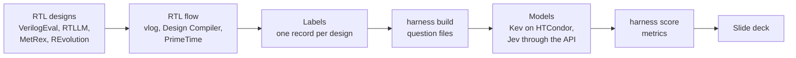

# JEV_RTL

JEV_RTL is a benchmark for decision models on questions about RTL designs. It measures how well Jev
(TypeSafe AI) and similar models answer questions about Verilog designs. The study covers two areas:
synthesizability, and hardware cost (area, power, and timing).

Each question has a correct answer from a real EDA flow: QuestaSim, Synopsys Design Compiler (DC), and
PrimeTime on the NanGate 15nm Open Cell Library. The model does not see the tool results of the design
that it must judge. This repo holds
the harness that makes the questions, the dataset, the scripts for the Kev runs on HTCondor, the
results, and the slide deck of the findings.



## Status

| Part | State |
|---|---|
| Harness | Ready. See [notes/VERIFICATION.md](notes/VERIFICATION.md) for the evidence. |
| Dataset v1 | 151 designs, 348 requests, 875 questions. |
| Kev-0.8B, Kev-4B, Kev-9B, Kev-27B | Complete: one run without examples, and one run with three solved examples per question. |
| Jev 1.13 (`jev-1.13.0`) | No results in this repo yet. The run needs a TypeSafe API key. |

## The questions

One test is one RTL design. Each design gets one `vlog -sv` run and one flow run at 500 MHz. These
runs give the correct answers of all the questions about the design. The questions go in separate
requests, so that no question shows the answer of a different question.

| Request | Question key | The question to the model | Answer | Questions |
|---|---|---|---|---|
| basic | `compiles` | Does the design compile? | yes or no | 151 |
| basic | `synthesizes` | Does DC synthesize the design? | yes or no | 151 |
| reason | `reason` | Why does DC not synthesize the design? | 1 of 10 classes | 25 |
| performance | `slack` | Which level is the worst slack at 500 MHz? | 1 of 5 levels | 110 |
| performance | `reach` | Which level is the reachable clock frequency? | 1 of 5 levels | 110 |
| performance | `area` | Which level is the area? | 1 of 5 levels | 110 |
| performance | `power` | Which level is the power, for the given power testbench? | 1 of 5 levels | 98 |
| pair | `smaller_area` | Which of two variants has the smaller area? | A or B | 58 |
| pair | `lower_power` | Which of two variants has the lower power? | A or B | 50 |
| pair | `higher_reach` | Which of two variants reaches the higher clock frequency? | A or B | 12 |

The levels of the performance questions:

| Question | Level 1 | Level 2 | Level 3 | Level 4 | Level 5 |
|---|---|---|---|---|---|
| `slack` | negative | 0 to 0.5 ns | 0.5 to 1.0 ns | 1.0 to 1.5 ns | 1.5 ns or more |
| `reach` | below 1 GHz | 1 to 2 GHz | 2 to 3 GHz | 3 to 4 GHz | 4 GHz or more |
| `area` | below 100 GE | 100 to 1,000 GE | 1,000 to 10,000 GE | 10,000 to 100,000 GE | 100,000 GE or more |
| `power` | below 10 uW | 10 to 100 uW | 100 uW to 1 mW | 1 to 10 mW | 10 mW or more |

- 1 gate equivalent (GE) is the area of `NAND2_X1`, which is 0.196608 um2 in this library.
- The reachable frequency is 1000 / (clock period - worst slack) MHz of the 500 MHz netlist.
- Each pair is asked in both orders (A/B and B/A). A pair counts only if one of its values differs by
  10% or more.

[notes/README.md](notes/README.md) and the six notes of the question types give the full definitions.

## How the correct answers are made

All correct answers come from one flow: [flow/RTL_flow_Nangate15](flow/RTL_flow_Nangate15). The
harness runs the step scripts of this flow in a separate run folder for each design. It never changes a
file of the flow.

- Tools: QuestaSim 2022.4, Design Compiler U-2022.12-SP2 (`compile_ultra -gate_clock`), and PrimeTime
  U-2022.12-SP2.
- Library: NanGate 15nm Open Cell Library, typical corner, 0.8 V, 25 C.
- Constraints: input and output delay of 0.1 x the clock period, clock uncertainty 50 ps, maximum
  transition 0.25 ns, and maximum fanout 32.
- Power: PrimeTime annotates the switching activity of the power testbench onto the netlist.

The flow settings do not change during the study. If a setting must change, all tests must run again.

## Dataset v1

The file [data/questions/dataset_v1.jsonl](data/questions/dataset_v1.jsonl) holds the questions. Its
data card is [data/questions/dataset_v1.card.md](data/questions/dataset_v1.card.md).

| Group | Designs | Purpose |
|---|---|---|
| `metrex` | 40 | Performance questions over a wide range of sizes (MetRex). |
| `revolution` | 10 | Real designs of medium size (REvolution v0). |
| `reference` | 15 | Designs that people wrote (RTLLM verified designs, VerilogEval reference designs). |
| `revold` | 32 | Pair questions on candidates of earlier REvolution runs. |
| `mutant` | 16 | The `reason` question: each mutant has one edit that DC rejects. |
| `trap` | 10 | Edits that DC accepts (`#1` delay, `initial`, `$display`), each with a twin that DC rejects. |
| `natural` | 20 | Code that an LLM wrote (failed REvolution candidates, RTLLM LLM files). |
| `noncompile` | 8 | The `compiles` question: one removed `;` or one undeclared name. |

- The split is by base design: 20% development, 80% test. Thus no design is in both sets.
- The test split has 281 requests with 725 questions. The development split has 67 requests with 150
  questions.
- All requests are below 8,000 tokens (estimate). This is in the validated context of Kev-0.8B, Kev-4B,
  and Kev-9B.

The few-shot file [data/questions/dataset_v1_fewshot3.jsonl](data/questions/dataset_v1_fewshot3.jsonl)
holds the same 725 test questions, one question per request. Each request also holds three solved
development examples of the same metric. Its data card gives the examples as the model reads them.

## Results

The four Kev models ran on HTCondor at ESAT on 2026-10-15 and 2026-10-16. The table gives the balanced
accuracy in % on the 725 test questions. Each cell gives the first run, then the run with three solved
examples per question.

| Question (test questions) | Kev-0.8B | Kev-4B | Kev-9B | Kev-27B |
|---|---|---|---|---|
| Does it compile? (114 yes, 9 no) | 52 -> 50 | 50 -> 66 | 61 -> 71 | 94 -> 97 |
| Does it synthesize? (99 yes, 24 no) | 50 -> 50 | 49 -> 54 | 53 -> 58 | 58 -> 73 |
| Reason, 10 classes (16) | 18 -> 4 | 38 -> 44 | 50 -> 50 | 88 -> 75 |
| Slack level (92) | 20 -> 25 | 12 -> 20 | 1 -> 30 | 13 -> 29 |
| Frequency level (92) | 25 -> 24 | 21 -> 34 | 25 -> 24 | 25 -> 37 |
| Area level (92) | 20 -> 20 | 20 -> 49 | 47 -> 51 | 48 -> 42 |
| Power level (85) | 25 -> 0 | 27 -> 42 | 37 -> 32 | 23 -> 39 |
| Smaller area, pair (46) | 48 -> 50 | 76 -> 67 | 87 -> 76 | 78 -> 89 |
| Lower power, pair (44) | 64 -> 55 | 57 -> 64 | 66 -> 70 | 70 -> 80 |
| Higher frequency, pair (12) | 67 -> 50 | 83 -> 50 | 75 -> 75 | 83 -> 92 |

- A fixed answer to every question gives 50 on a yes/no question and on a pair question. On a level
  question, a fixed answer gives 25 for slack, frequency, and power, and 20 for area.
- In the first run, Kev-0.8B answered "yes" to every synthesis question of the test split.
- Kev-27B has the highest balanced accuracy on 7 of the 10 questions in the run with examples.

[results/kev/dataset_v1_fewshot3_summary.md](results/kev/dataset_v1_fewshot3_summary.md) also gives the
accuracy and the paired McNemar test for each question. The slide deck
[presentations/KEV_RTL_findings_20261015.pdf](presentations/KEV_RTL_findings_20261015.pdf) gives one
slide per question.

## Repository layout

| Folder | Content |
|---|---|
| [harness/](harness/) | The Python harness: plans, label jobs, question builder, runner, scorer, and compare tool. |
| [flow/RTL_flow_Nangate15/](flow/RTL_flow_Nangate15/) | The RTL flow that gives all correct answers. `RTL_flow_Nangate15.zip` is the original archive. |
| [data/questions/](data/questions/) | The question files of dataset v1 and of the few-shot variant, each with a data card. |
| [data/pilot/](data/pilot/) | Small smoke files for test runs. |
| [condor/](condor/) | The scripts that run the Kev models on HTCondor, the submit files, the logs, and a copy of the Kev source. |
| [results/kev/](results/kev/) | The answers, the metrics, and the manifest of each Kev run, and the summary table. |
| [results/kev_localtest/](results/kev_localtest/) | Local test runs of Kev on a CPU. |
| [presentations/](presentations/) | The findings deck (PPTX and PDF), the scripts that build it, and the verified numbers. |
| [notes/](notes/) | The test definitions, the dataset rules, the harness description, the verification evidence, and the status. |
| [probes/](probes/) | Small probe scripts and their logs. |
| [pwp_example/](pwp_example/) | The PowerPoint file that supplies the theme of the findings deck. |
| `Condor_REPO/condor-control` | A git link to the ESAT HTCondor tools. Its content is not in this repo. |

## Use

Run all commands from the root folder of the repo. The harness stores its run folders and labels in
`/volume1/users/scuycken/jev_rtl_work` on mercury. To use a different work folder, set `JEV_WORK_DIR`.

Check the harness. This check starts no EDA tool:

```bash
python3.12 -m harness selftest
```

Make the labels. This step needs the EDA tools and their licenses. With one license, it takes about 3.5
to 5 hours:

```bash
python3.12 -m harness label design --plan dataset_v1
python3.12 -m harness status design
```

Build the question files. This step starts no EDA tool:

```bash
python3.12 -m harness build dataset_v1     # writes data/questions/dataset_v1.jsonl
python3.12 -m harness.fewshot              # writes data/questions/dataset_v1_fewshot3.jsonl
```

Run a Kev model on HTCondor. Submit the job from mercury. The job answers the smoke file first, and
continues with the full dataset only if the smoke file passes:

```bash
condor/submit_kev.sh --out results/kev/<output folder> kev-4b \
    data/pilot/dataset_v1_smoke.jsonl data/questions/dataset_v1.jsonl
condor_q -nobatch
```

Run Jev through the TypeSafe API:

```bash
export TYPESAFE_API_KEY=<your key>
python3.12 -m harness.runner data/questions/dataset_v1.jsonl --model jev
```

Score an answer file on the test split, and compare two runs on the same questions:

```bash
python3.12 -m harness.score data/questions/dataset_v1.jsonl --model kev \
    --answers <answer file> --split test
python3.12 -m harness.compare <base questions> <base answers> <new questions> <new answers>
```

[notes/HARNESS.md](notes/HARNESS.md) gives all harness commands and options.
[condor/README.md](condor/README.md) gives the HTCondor commands, the resources of each model, and the
job history. [presentations/README.md](presentations/README.md) gives the commands that rebuild the
deck.

## Requirements

- Python 3.12. The harness uses only the Python standard library.
- For the labels: QuestaSim, Design Compiler, and PrimeTime, with a license for each. The harness runs
  one tool at a time, because the DC licenses are shared.
- For the Kev runs: access to HTCondor at ESAT, and an NVIDIA GPU with CUDA compute capability 8.0 or
  higher. The job installs uv, Python 3.12, and the Kev environment on the scratch disk.
- For the Jev runs: a TypeSafe API key in `TYPESAFE_API_KEY`.
- For the deck: Python with `python-pptx` 1.0.2.
- For the full self-test: the REvolution designs in
  `/users/micas/scuycken/Claude/RTL_LLM_Loop_REvolution`. If this folder is not available, one of the six
  checks fails.

## Sources and licenses

| Source | Origin | License |
|---|---|---|
| VerilogEval, `dataset_spec-to-rtl` (commit c498220) | NVIDIA | MIT |
| RTLLM v2.0 (commit 51ed553) | HKUST | MIT |
| MetRex | MetRex authors | BSD-3-Clause |
| REvolution designs and runs | MICAS, KU Leuven | not published |
| Kev source in [condor/kev_src/](condor/kev_src/) (commit 5e42a7a of <https://github.com/jaredpalmer/kev>) | Kev authors | Apache-2.0 |
| NanGate 15nm Open Cell Library in [flow/RTL_flow_Nangate15/tech/](flow/RTL_flow_Nangate15/tech/) | Silvaco Inc. | Apache-2.0, for research and development only (see `NOTICE.txt`) |

[notes/DATA.md](notes/DATA.md) gives the details of each source and which test uses it.

## More information

| File | Content |
|---|---|
| [notes/README.md](notes/README.md) | The scope, the question types, the models, the metrics, and the rules for all tests. |
| [notes/DATASET.md](notes/DATASET.md) | The structure and the rules of dataset v1. |
| [notes/DATA.md](notes/DATA.md) | The design sources and the generated variants. |
| [notes/HARNESS.md](notes/HARNESS.md) | How the harness runs a design, the plans, and the commands. |
| [notes/VERIFICATION.md](notes/VERIFICATION.md) | The evidence that the harness is correct. |
| [notes/STATUS.md](notes/STATUS.md) | The state of the work and the remaining work. |
